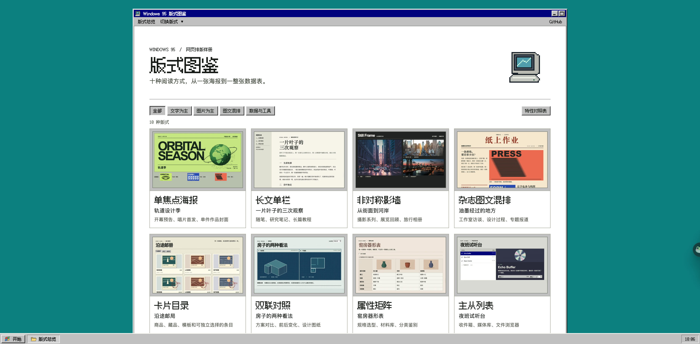

# Win95 Desktop Atlas

[中文说明](README.zh-CN.md) · [GitHub repository](https://github.com/holynova/win95-desktop-atlas) · [Cloudflare demo](https://win95-desktop-atlas.xiaosang.cc/)

Eight fictional creative studios share a Windows 95 desktop. Open **Start** to visit a different studio. The screenshot shows a mountain stamp after its first postmark.



| Desk | Try it |
| --- | --- |
| Orbit Office | Open a poster and use the arrow keys to browse the series. |
| Still Frame | Read the composition notes for three city photographs. |
| Soft Signal | Play three original electronic sketches on a compact disc player. |
| Field Notes | Magnify a fern, a fan leaf or a lance-shaped leaf. |
| Fold Works | Compare architectural models with their floor plans. |
| Kiln Room | Change the glaze while keeping the vessel and lighting fixed. |
| Post Club | Stamp a travel postage design, then inspect its mint condition. |
| Night Atlas | Hide the constellation lines and find the outlines again. |

## Run locally

Requires Node.js for checks and Python 3 for the local server. No application dependencies.

```sh
npm run check
python3 -m http.server 8000 --directory dist
```

Open `http://localhost:8000`. All samples, photos and audio are served from `dist/assets`. The city photographs come from Unsplash. The collaboration form downloads a text file locally.

## Publish

Cloudflare Pages builds the GitHub production branch **main**, runs `npm run check`, and serves `dist/`. After committing a change, publish with `git push origin main`.


