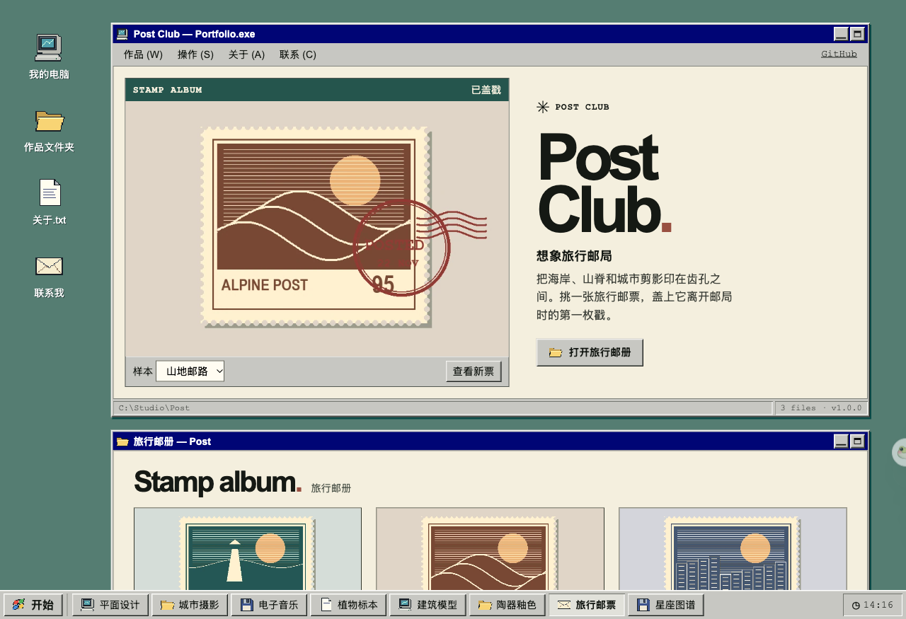

# Windows 95 桌面图鉴

[English](README.md) · [GitHub 仓库](https://github.com/holynova/win95-desktop-atlas) · [Cloudflare 演示](https://win95-desktop-atlas.xiaosang.cc/)（域名待验证）

八间虚构的创作工作室共用一个 Windows 95 桌面。从「开始」菜单进入任意主题，下图是旅行邮局为一枚山地邮票盖戳后的画面。



| 工作室 | 可以体验 |
| --- | --- |
| Orbit Office · 平面设计 | 打开系列海报，用方向键翻页。 |
| Still Frame · 城市摄影 | 沿着三张照片，阅读街道、楼群和河岸的构图笔记。 |
| Soft Signal · 电子音乐 | 用 CD 播放器试听三段原创电子小样。 |
| Field Notes · 植物标本 | 放大蕨叶、扇叶或披针形叶的局部。 |
| Fold Works · 建筑模型 | 在建筑轴测图和平面图之间切换。 |
| Kiln Room · 陶器釉色 | 在同一器形和侧光下比较两种釉色。 |
| Post Club · 旅行邮票 | 给海岸、山地或城市邮票盖戳，再换回新票。 |
| Night Atlas · 星座图谱 | 隐去连线，看能否认出三组亮星。 |

## 本地运行

使用 Node.js 做检查，使用 Python 3 启动预览。应用无需安装依赖。

```sh
npm run check
python3 -m http.server 8000 --directory dist
```

打开 `http://localhost:8000`。图像、标本和音频都在 `dist/assets` 中，城市照片选自 Unsplash。合作简报在浏览器中保存为本地文本。

## 发布

Cloudflare Pages 绑定 GitHub 生产分支 **main**，运行 `npm run check`，托管 `dist/`。提交改动后执行 `git push origin main` 发布。


